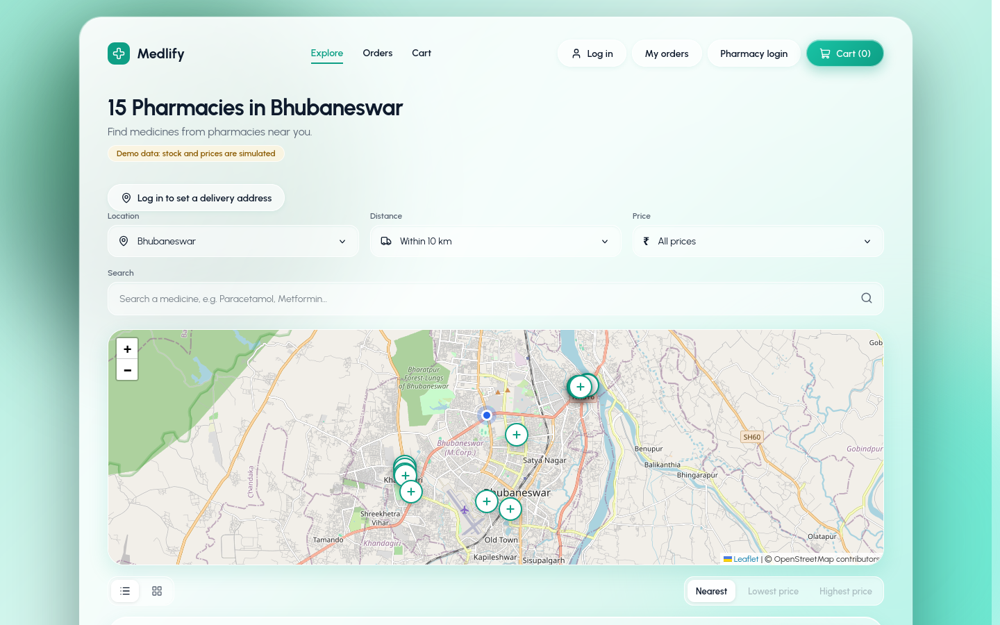
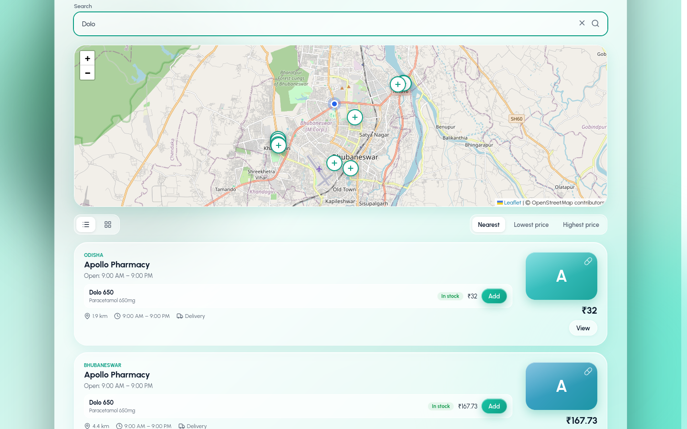
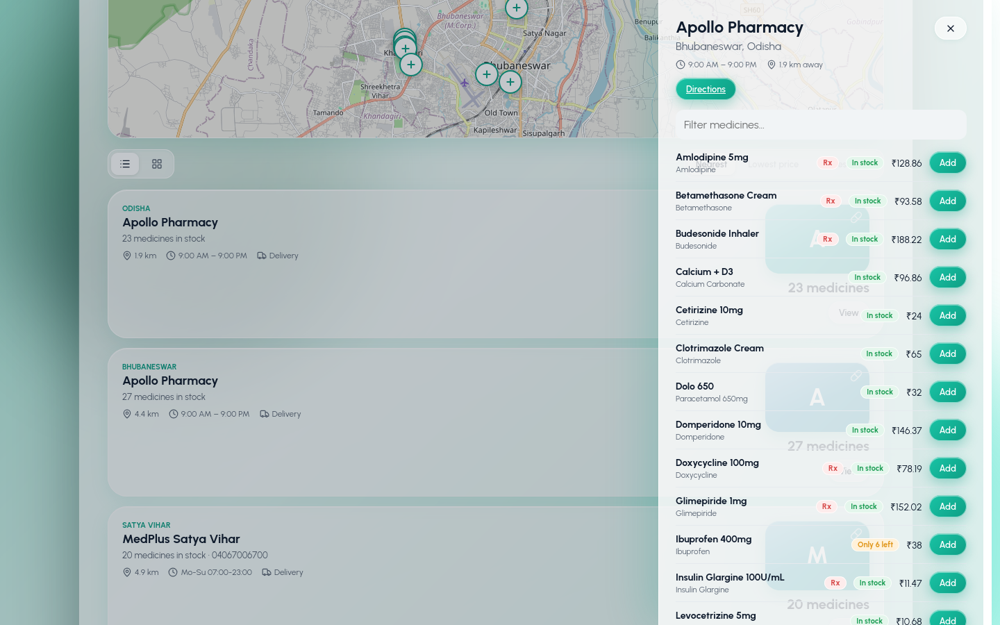
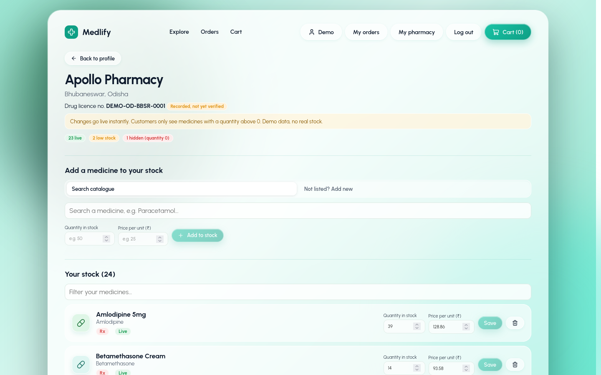
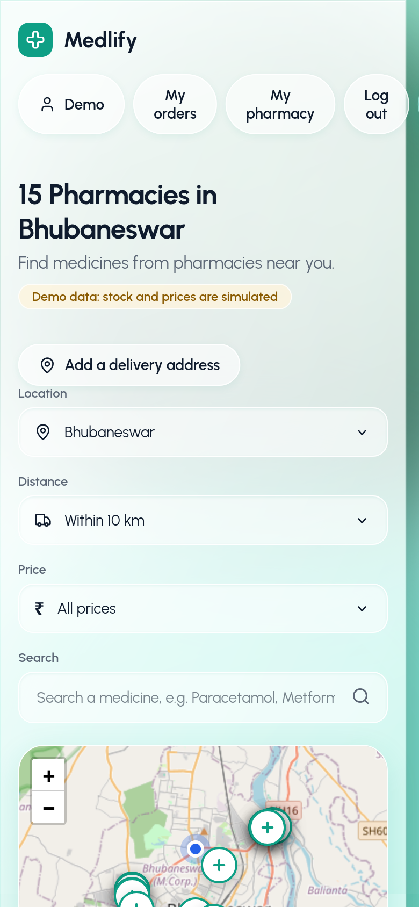

# Medlify

Find medicines at nearby pharmacies. Pharmacies manage live stock and prices, and customers see them instantly.

**Live demo: https://medlify-one.vercel.app**

| Role | Phone | Password |
|---|---|---|
| Customer | `9000000002` | `Demo@1234` |
| Pharmacy owner | `9000000001` | `Demo@1234` |

> The free backend sleeps after 15 minutes idle, so the first load can take 30–50 seconds.

## Screenshots

**Pharmacies near you, on a map**

**Search a medicine and compare price and distance**

**A pharmacy's live stock**

**Pharmacy owner dashboard: update stock and prices**

**On mobile**

## Features
- Map and list of pharmacies within a chosen distance, sorted by nearest or price
- Medicine search with prices from every nearby pharmacy, cart and orders
- Customer accounts with saved delivery addresses
- Pharmacy owner dashboard: add medicines, set quantity and price, changes go live instantly

## Tech
- **Frontend:** React + Vite, Leaflet maps, deployed on **Vercel**
- **Backend:** Node.js + Express, JWT auth, deployed on **Render** (`render.yaml`)
- **Database:** PostgreSQL + PostGIS on **Neon**

## Run it locally
1. Start a PostgreSQL database with PostGIS (or use a free [Neon](https://neon.tech) database).
2. `cd backend && npm install`, then create `backend/.env` from `.env.example` (`DATABASE_URL`, `JWT_SECRET`, `PORT=3001`).
3. `node scripts/bootstrap-db.js` creates the tables, runs migrations, imports pharmacies from OpenStreetMap and creates the demo logins.
4. `npm start` (backend), then in a second terminal `cd frontend && npm install && npm run dev` and open http://localhost:5173

## Deploy
- **Database:** create a Neon project and copy its connection string.
- **Backend:** on Render choose *New → Blueprint* and pick this repo. Set `DATABASE_URL` to the Neon string and `CORS_ORIGIN` to the frontend URL. The database sets itself up on first start.
- **Frontend:** deploy `frontend/` on Vercel with `VITE_API_URL` set to the backend URL.

## Data
Pharmacy names and locations come from OpenStreetMap (Bhubaneswar area). Stock, prices and licence numbers are demo data, and licence numbers are recorded but not verified against any register.
